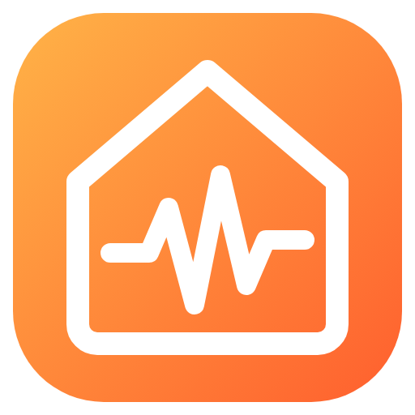
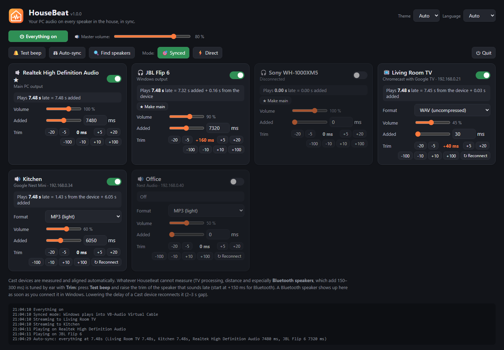
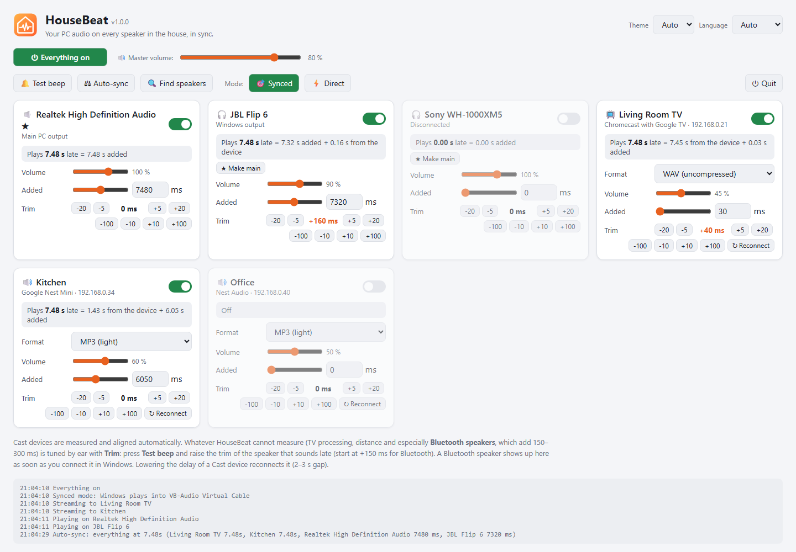
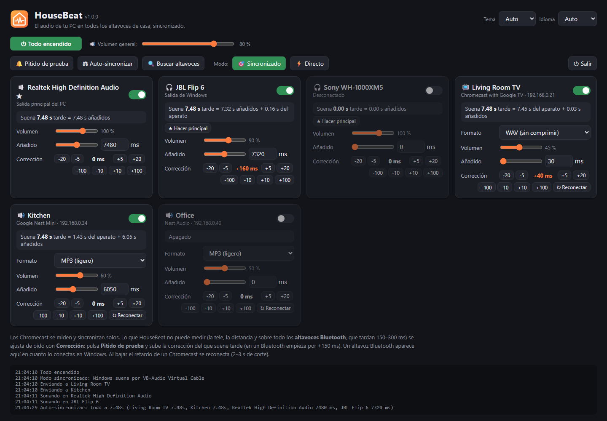
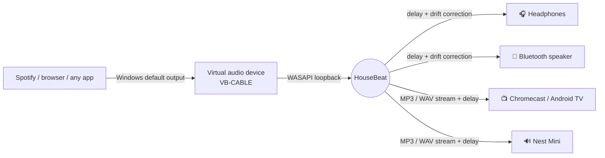
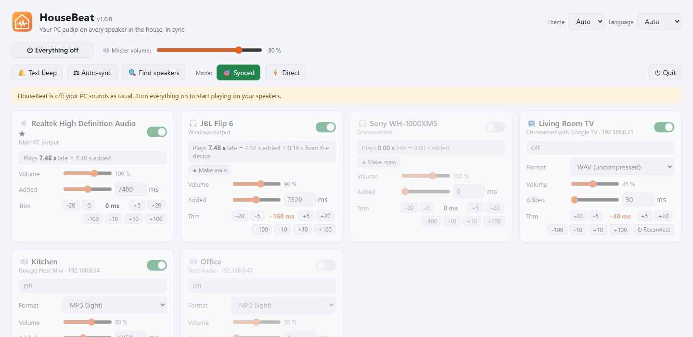

<div align="center">



# HouseBeat

**Your PC audio on every speaker in the house, in sync.**

Chromecasts, Google Nest speakers, Android TV boxes, Bluetooth speakers and your own headphones, all playing the same song at the same time, from a single Windows PC.

[](https://github.com/CodeOfVictor/HouseBeat/releases/latest)


[](LICENSE)



</div>

---

## Why HouseBeat?

Google Home can group Nest speakers, but it cannot add your PC, your Android TV box or a Bluetooth speaker to the group. Casting tools can send audio everywhere, but every device plays it with a different delay: one to two seconds on a Nest Mini, seven or more on an Android TV box, a few hundred milliseconds on Bluetooth. In the same room, that sounds like an echo.

HouseBeat captures whatever your PC is playing (Spotify, YouTube, a game, anything) and sends it to every speaker, **measuring each one and delaying the faster ones so they all play in lockstep**.

## Features

- 🔊 **Any Google Cast device**: Chromecast, Chromecast with Google TV, Nest Mini, Nest Audio, Android TV boxes with Chromecast built in. They are discovered automatically as soon as they power on.
- 🎧 **Any Windows output**: speakers, headphones and **Bluetooth speakers**, several at once, each with its own delay.
- ⚖️ **Automatic sync**: HouseBeat measures how late every Cast device really plays and aligns everything to the slowest one, by itself, every time a speaker starts.
- 🎚️ **Per-speaker trim by ear**: for what no software can measure (TV audio processing, Bluetooth, the distance to each speaker), with a test beep to align them.
- 🕰️ **Clock drift correction**: every device has its own clock. HouseBeat nudges playback speed by a fraction of a percent instead of jumping, so the speakers stay together for hours.
- 🎛️ **One control panel**: a master switch, master volume and per-speaker volume, all in the browser.
- 🌗 **Light and dark theme**, and the panel in **English or Spanish**, picked automatically.
- 🧳 **Portable**: a single `.exe` with no installer. Your settings live in `%APPDATA%\HouseBeat`.

<div align="center">


</div>

## How it works



1. **Capture.** When HouseBeat is on, Windows plays into a *virtual* audio device, so nothing reaches your speakers directly. HouseBeat records it into a 20-second ring buffer.
2. **Windows outputs.** Each output plays from that buffer with its own delay. Small clock differences are corrected by resampling a few samples at a time.
3. **Cast devices.** Each Cast device gets its own live HTTP stream from the PC. HouseBeat compares what it has sent with the playback position the device reports, which gives the real latency of every speaker.
4. **Alignment.** Everything is delayed to match the slowest speaker. Cast devices only ever get *more* delay (silence is inserted, so the music never cuts), and Windows outputs are set directly.

When HouseBeat is off, Windows plays on your main output as usual.

## Getting started

### 1. Requirements

- Windows 10 or 11.
- Your Cast devices on the same network as the PC.
- **[VB-CABLE](https://vb-audio.com/Cable/)** (free) for **synced mode**, the one where your PC speakers are delayed too. HouseBeat also detects *Steam Streaming Speakers* and *Voicemeeter* if you already have them. Without a virtual device, HouseBeat still works in **direct mode**: the PC plays live and only the other speakers are aligned among themselves.

### 2. Install

1. Download **`HouseBeat.exe`** from the [latest release](https://github.com/CodeOfVictor/HouseBeat/releases/latest).
2. Run it. The control panel opens in your browser and a HouseBeat icon appears in the system tray.
3. When Windows Firewall asks, **allow HouseBeat on private networks**. Your Cast devices fetch the audio stream from the PC; without this they stay silent.

> Windows SmartScreen may warn about an unknown publisher, because the executable is not code-signed. Click **More info → Run anyway**, or [run it from source](#run-from-source).

### 3. Play



HouseBeat always **starts switched off**, so opening it never takes over your speakers.

1. Switch on the speakers you want in their cards.
2. Press **⏻ Everything off** to turn it on. HouseBeat starts streaming and syncs everything automatically after a few seconds.
3. Play music on your PC as usual.

## Fine-tuning

| What you hear | What to do |
|---|---|
| One speaker sounds slightly late (a TV, a Bluetooth speaker) | Raise its **Trim** with **+5 / +20** while **🔔 Test beep** is playing. Everything re-syncs by itself. |
| One speaker sounds slightly early | Lower its **Trim**. |
| A Bluetooth speaker | Start at **+150 ms** of trim and adjust by ear. Bluetooth latency cannot be measured from the PC. |
| Speakers drifted apart after a long session | Press **↻ Reconnect** on the Cast device that drifted, then **⚖ Auto-sync**. |
| An old Chromecast or Android TV box is very late | Try **Format → WAV**. Some devices buffer far less audio with uncompressed WAV than with MP3. |

**Modes**

- **🎯 Synced**: all Windows audio goes through HouseBeat, so the PC speakers can be delayed to match the rest. Everything on the PC is delayed, so switch to direct mode for games or videos.
- **⚡ Direct**: the PC plays live, with no delay. Only the other speakers are delayed, aligned among themselves.

The total latency is set by your slowest speaker. A Nest Mini alone adds about 1.5 s, and some Android TV boxes add 7 s or more. That is fine for music, but it is the delay you will hear when you press play or skip a song.

## Troubleshooting

<details>
<summary><b>A Cast device shows up but stays silent</b></summary>

Windows Firewall is probably blocking the stream. Allow HouseBeat on private networks: *Windows Security → Firewall & network protection → Allow an app through firewall*. The PC and the speakers must be on the same network, and the network profile in Windows must be **Private**.
</details>

<details>
<summary><b>Everything went silent when I connected a Bluetooth speaker</b></summary>

Windows makes a newly connected Bluetooth device the default output. HouseBeat detects this and switches it back within a second while it is on. If a music app is pinned to a specific device in *Settings → System → Sound → Volume mixer*, set it back to **Default**.
</details>

<details>
<summary><b>"Synced" is greyed out</b></summary>

No virtual audio device was found. Install [VB-CABLE](https://vb-audio.com/Cable/), reboot, and restart HouseBeat.
</details>

<details>
<summary><b>My PC has no sound after HouseBeat closed unexpectedly</b></summary>

Pick your speakers or headphones again from the speaker icon in the taskbar. When you quit from the panel or the tray icon, HouseBeat puts the original output back by itself.
</details>

<details>
<summary><b>A Cast device was switched off in the panel by itself</b></summary>

Another app (YouTube, Netflix…) started casting to it. HouseBeat steps aside instead of fighting for the device. Switch it on again when you are done.
</details>

## Run from source

```bat
git clone https://github.com/CodeOfVictor/HouseBeat.git
cd HouseBeat
start.bat
```

`start.bat` creates a virtual environment, installs [`requirements.txt`](requirements.txt) the first time, and runs HouseBeat without a console window. Python 3.10 or newer is required.

To build the portable executable yourself:

```bat
build.bat
```

The result is `dist\HouseBeat.exe`.

**Environment variables**

| Variable | Default | Purpose |
|---|---|---|
| `HOUSEBEAT_PORT` | `8770` | Port of the control panel and the audio streams |
| `HOUSEBEAT_DATA_DIR` | `%APPDATA%\HouseBeat` | Where `config.json` is stored |
| `HOUSEBEAT_NO_BROWSER` | — | Set to `1` to skip opening the panel on start |

## Project layout

```
housebeat.py      Audio engine, Cast streaming, sync and the local web server
winaudio.py       Switches the Windows default output (IPolicyConfig)
web/              Control panel: HTML, CSS, JavaScript, translations, logo
housebeat.spec    PyInstaller build definition
```

## Privacy

HouseBeat runs entirely on your PC and your local network. It has no accounts, no telemetry and no cloud. The control panel only accepts changes from the PC itself. Other devices on your network can only fetch the audio streams.

## Credits

Built on [SoundCard](https://github.com/bastibe/SoundCard), [PyChromecast](https://github.com/home-assistant-libs/pychromecast), [lameenc](https://github.com/chrisstaite/lameenc), [comtypes](https://github.com/enthought/comtypes) and [pystray](https://github.com/moses-palmer/pystray). VB-CABLE is a product of [VB-Audio](https://vb-audio.com/) and is not bundled with HouseBeat.

## License

[MIT](LICENSE) © CodeOfVictor
